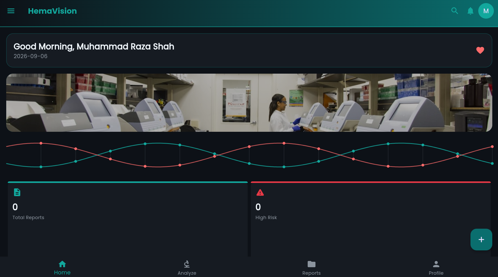
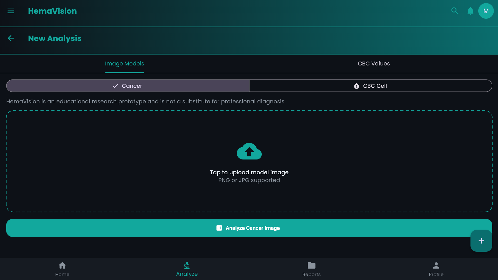
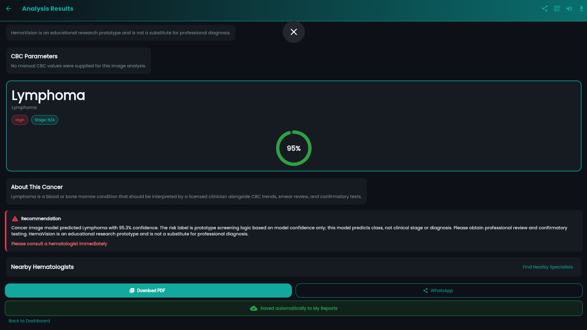
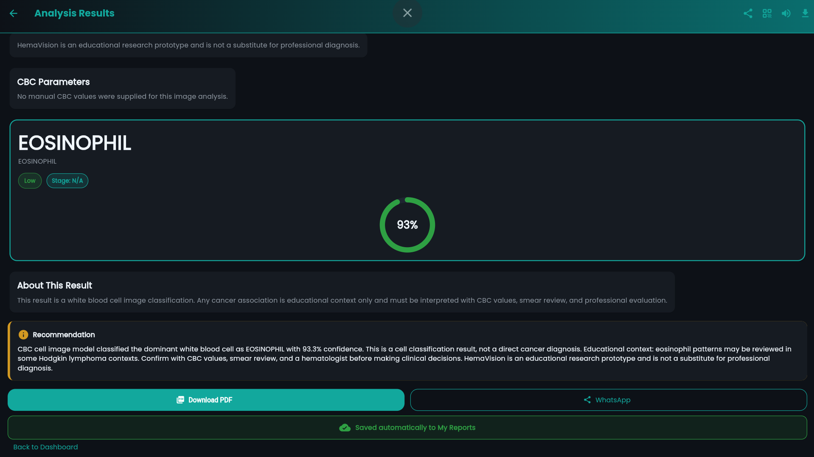
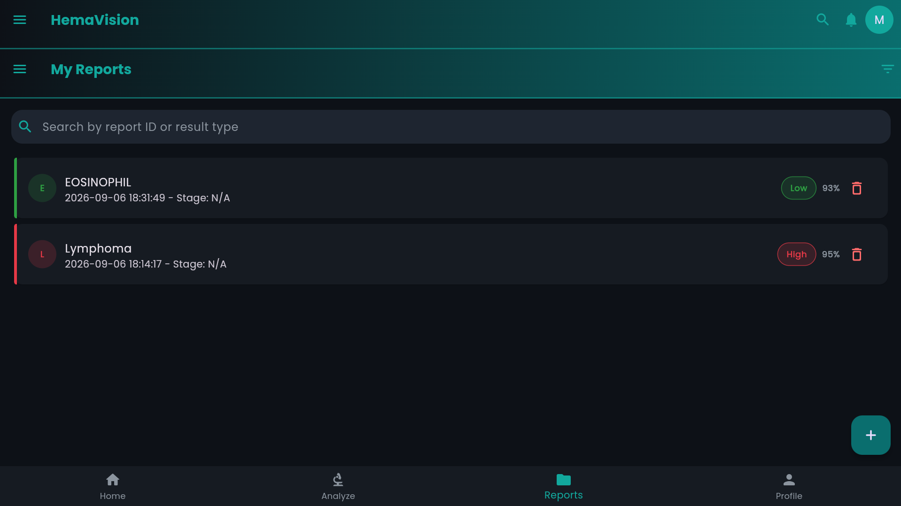
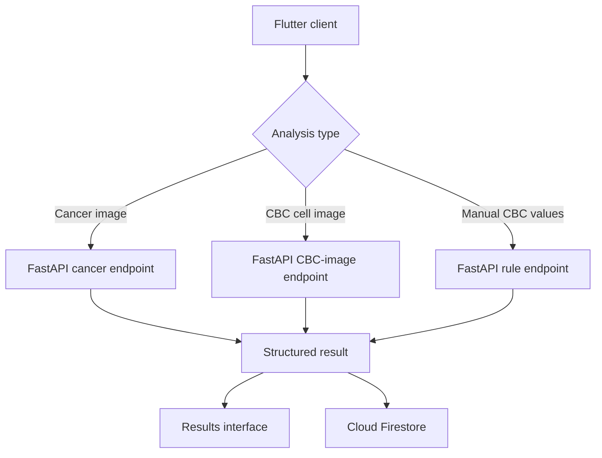

# HemaVision - Flutter Blood Analysis Research Prototype

HemaVision is a Flutter application that connects to a local FastAPI and PyTorch inference service for experimental blood-image classification and CBC-value screening. It combines three separate analysis workflows with Firebase authentication, report history, dashboard visualizations, export tools, and configurable themes.

> **Medical disclaimer:** HemaVision is an educational research prototype. Its classifications, risk labels, and rule-based estimates are not clinically validated diagnoses and must not replace evaluation by a qualified medical professional.

## Verified status

The current project has been functionally verified on Windows using Flutter's Chrome target and a locally running Python model bridge.

- Both Vision Transformer models load successfully through `/warmup`.
- Cancer-image and CBC-cell image inference return structured results.
- Manual CBC screening returns deterministic rule-based results.
- Authenticated analysis results are stored in Cloud Firestore.
- Report history, search, filtering, opening, and deletion work.
- `flutter test` passes.
- `flutter analyze` reports no errors or warnings; remaining findings are informational lint notices.

The Android frontend has been installed on a physical phone through Android Studio. The installed app currently runs as a frontend without a connected model bridge. Image inference is verified in Flutter web on Chrome on a Windows laptop, using the local FastAPI/PyTorch model bridge. The models run on the computer and are not embedded in the mobile app.

## Screenshots

### Dashboard



### Analysis modes



### Cancer image classification



### CBC cell classification



### Report history



## Analysis workflows

| Workflow | Input | Output | Important limitation |
|---|---|---|---|
| Cancer image classification | Microscopic blood image | Leukemia, Lymphoma, Myeloma, or Normal; confidence and prototype risk label | Predicts a class, not a clinical diagnosis or cancer stage |
| CBC cell classification | Microscopic white blood-cell image | Eosinophil, Lymphocyte, Monocyte, or Neutrophil; confidence | Cell classification only; cancer associations are educational context |
| Manual CBC screening | 13 manually entered CBC values | Rule-based pattern, risk level, confidence-like score, and experimental stage estimate | Deterministic screening rules, not a trained model or validated staging system |

Image-only analyses correctly report stage as `N/A`. Manual CBC staging is explicitly labelled as an experimental rule-based estimate.

## Main features

- Firebase email/password authentication and user profiles
- Patient and doctor role selection during registration
- Dashboard statistics, charts, report summaries, news, and weather sections
- Cancer-image and CBC-cell image upload modes
- Manual entry for 13 CBC parameters
- Firestore-backed personal report history
- Search and filters by risk, result category, and analysis type
- Detailed result view with confidence, risk, method, and recommendations
- PDF report generation and printing
- WhatsApp sharing and QR-code report sharing
- Text-to-speech result narration
- Optional nearby hematologist search using Google Places and device location
- Multiple dark visual themes controlled from the profile interface
- Demo and local-fallback behavior for development

## Technology stack

### Flutter client

- Flutter 3.38.7
- Dart 3.10.7
- Material UI
- Firebase Authentication
- Cloud Firestore
- Firebase Storage configuration
- `http`, `image_picker`, `fl_chart`, `percent_indicator`, `lottie`
- `pdf`, `printing`, `url_launcher`, `flutter_tts`, `geolocator`
- `google_fonts`, `shimmer`, and `shared_preferences`

### Local inference service

- Python 3.13.9
- FastAPI 0.136.3
- Uvicorn 0.48.0
- PyTorch 2.12.0
- Transformers 5.9.0
- SafeTensors 0.7.0
- Pillow 12.2.0
- Pydantic 2.13.4

## Model information

Both image classifiers use `ViTForImageClassification` with 224 x 224 RGB inputs, 12 transformer layers, 12 attention heads, and a hidden size of 768.

| Model | Classes | Metadata checkpoint metric |
|---|---|---|
| Cancer image ViT | Leukemia, Lymphoma, Myeloma, Normal | Approximately 94.57% |
| CBC cell ViT | Eosinophil, Lymphocyte, Monocyte, Neutrophil | Approximately 88.95% |

These figures are values stored in the training metadata. They are not independent test results or measures of clinical performance.

Large `.safetensors` and `.pt` files are excluded from Git because they exceed normal GitHub file-size limits. See [`models/README.md`](models/README.md) for the required locations.

## Architecture



The Flutter client communicates with the local bridge over HTTP. The bridge loads model artifacts once and reuses them for subsequent inference requests.

## Repository structure

```text
HemaVision_Android/
|-- .gitignore
|-- README.md
|-- LICENSE
|-- docs/
|   `-- screenshots/
|-- models/
|   |-- README.md
|   |-- cancer_model/
|   `-- cbc_model/
`-- hemavision/
    |-- config_examples/
    |-- android/
    |-- ios/
    |-- lib/
    |-- model_bridge/
    |-- test/
    |-- web/
    |-- firebase.json
    |-- firestore.rules
    |-- storage.rules
    `-- pubspec.yaml
```

## Prerequisites

- Windows, macOS, or Linux development environment
- Flutter SDK compatible with Dart 3.10.7
- Python 3.13 or another version supported by the pinned dependencies
- A Firebase project for persistent authentication and report storage
- Local copies of both trained model-weight files
- Chrome for the currently verified web workflow, or an Android emulator/device for Android testing

## Configuration

Real Firebase and third-party API values are deliberately excluded from Git.

Safe templates are provided in:

```text
hemavision/config_examples/api_keys.dart.example
hemavision/config_examples/firebase_options.dart.example
```

Copy them to their runtime locations:

```powershell
Copy-Item .\hemavision\config_examples\api_keys.dart.example .\hemavision\lib\utils\api_keys.dart
Copy-Item .\hemavision\config_examples\firebase_options.dart.example .\hemavision\lib\firebase_options.dart
```

Replace every `YOUR_...` placeholder with configuration for your own Firebase project and optional API services. Alternatively, configure Firebase with FlutterFire and retain the project's `isDemoConfig` compatibility flag.

Optional services degrade to fallback content when their keys are not configured.

## Model setup

Place the trained SafeTensors artifacts at:

```text
models/cancer_model/model.safetensors
models/cbc_model/model.safetensors
```

`models/cbc_model/cbc_best.pt` can also be supplied as the bridge's fallback CBC checkpoint format.

The bridge uses repository-relative paths by default. Different locations can be supplied through the `CANCER_MODEL_DIR` and `CBC_MODEL_DIR` environment variables.

## Install the Flutter application

From the repository root:

```powershell
cd .\hemavision
flutter pub get
```

## Install and start the model bridge

```powershell
cd .\model_bridge
python -m venv .venv
.\.venv\Scripts\Activate.ps1
python -m pip install --upgrade pip
pip install -r requirements.txt
python -m uvicorn server:app --host 127.0.0.1 --port 8000
```

In another terminal, verify and warm up both models:

```powershell
Invoke-RestMethod http://127.0.0.1:8000/health
Invoke-RestMethod http://127.0.0.1:8000/warmup -TimeoutSec 300
```

## Run the verified Chrome workflow

From `HemaVision_Android/hemavision`:

```powershell
flutter run -d chrome --dart-define=MODEL_BRIDGE_BASE=http://127.0.0.1:8000
```

Image inference uses a 120-second client timeout to support CPU execution of the large ViT models.

## Android connection

Start the bridge so it is reachable from another device:

```powershell
python -m uvicorn server:app --host 0.0.0.0 --port 8000
```

The Android emulator defaults to `http://10.0.2.2:8000`. For a physical phone on the same network:

```powershell
flutter run -d <device-id> --dart-define=MODEL_BRIDGE_BASE=http://<computer-ipv4>:8000
```

Firewall permission may be required. The frontend is installed on a physical phone, but end-to-end model inference from the Android app has not yet been validated.

## API endpoints

| Method | Endpoint | Purpose |
|---|---|---|
| `GET` | `/health` | Checks resolved model directories and loading state |
| `GET` | `/warmup` | Loads both ViT models into memory |
| `POST` | `/predict/cancer` | Runs cancer-image classification |
| `POST` | `/predict/cbc-image` | Runs white blood-cell image classification |
| `POST` | `/predict/cbc-values` | Runs experimental rule-based CBC screening |

Image endpoints accept multipart form data using the field name `file`.

## Firebase security

Firestore rules enforce ownership using the authenticated user's UID. Users can create, read, update, and delete only their own profile and report documents. Storage rules similarly restrict report-file paths to their owning user.

Review and deploy the rules to your own Firebase project before using persistent storage:

```powershell
firebase deploy --only firestore:rules,storage
```

Do not deploy rules to a production Firebase project without reviewing the selected Firebase project and testing the intended access behavior.

## Validation

Run Flutter checks from `HemaVision_Android/hemavision`:

```powershell
flutter analyze
flutter test
```

The latest verified test result was:

```text
00:14 +1: All tests passed!
```

## Limitations

- This is not a medical device and has not undergone clinical validation.
- Cancer-image confidence is used only for a prototype risk label; it is not a diagnosis.
- Cancer and CBC-cell image classifiers do not determine clinical stage.
- Manual CBC classification and staging are rule-based experimental logic.
- The project does not extract numeric CBC values from uploaded report documents through OCR.
- The Python bridge and large model artifacts must remain available while performing inference.
- Model weights are not included in the Git repository.
- The current validated demonstration target is Chrome on a Windows computer.
- External information, weather, nearby-specialist, sharing, and Firebase features require connectivity or configuration.

## Author

**Muhammad Raza Shah**  
BS Information Engineering Technology student, The Superior University, Lahore

- GitHub: [razashahm9-alt](https://github.com/razashahm9-alt)
- LinkedIn: [Muhammad Raza Shah](https://www.linkedin.com/in/muhammad-raza-shah)

## License

This project is available under the [MIT License](LICENSE).


